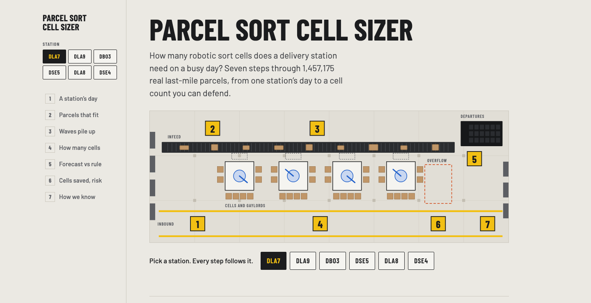
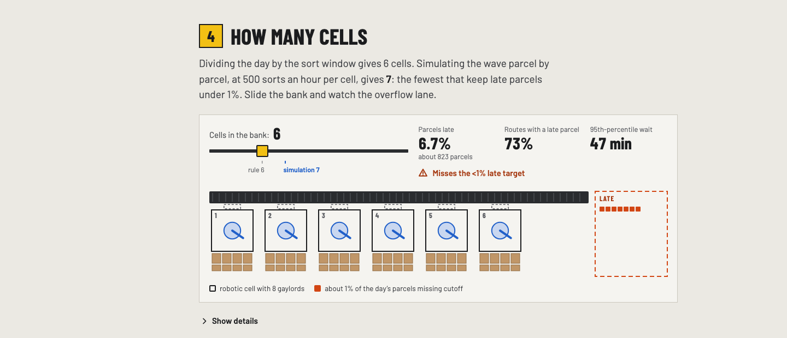
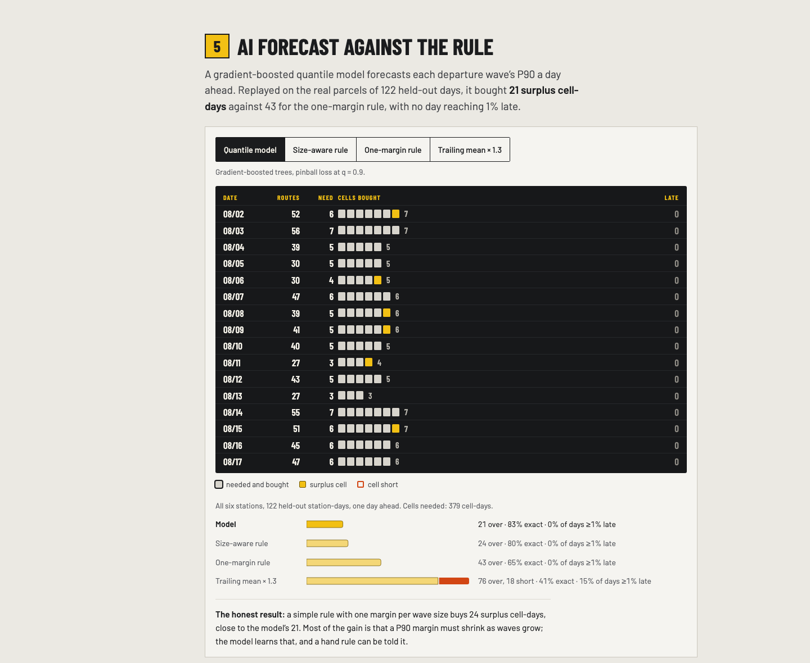
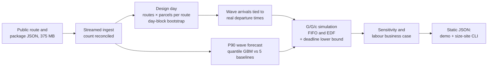

# Parcel Sort Cell Sizer

**How many robotic sort cells a delivery station needs on a busy day, measured on 899,387 real parcels instead of a spreadsheet average.**

[](pipeline/tests)
[](LICENSE)
[](https://registry.opendata.aws/amazon-last-mile-challenges/)
[](pipeline/pyproject.toml)
[](package.json)

[](https://ibiraheel.com/demos/parcel-sort-cell-sizer/)

**[Live demo](https://ibiraheel.com/demos/parcel-sort-cell-sizer/)** · [Method](METHOD.md) · [Solution playbook](SOLUTION.md) · [Full-page screenshot](docs/img/full-page.png)

---

## The question

How many robotic sort cells does a delivery station need to make every departure on a busy day, and how big a safety margin should the volume forecast carry?

## The answer

More than the average says. Sizing on average throughput (busy-day volume divided by the sort window) came up **one cell short at 3 of 6 stations** in simulation, and one cell short left **5.5–34% of parcels late**. Sizing against the departure waves, with a P90 forecast margin that shrinks as waves grow, closed the gap: on 122 held-out station-days it bought **24 surplus cell-days where one flat margin bought 43**, and no day reached 1% late.

## The solution

[SOLUTION.md](SOLUTION.md) is a one-page, five-step sizing recipe with the margin table, the decision rules and a week-1 plan for one site. `size-site` is a small CLI that turns a station's route plan (CSV or the public files) into a cell count, the risk of one cell short, a ranked list of what to measure first on the site visit, and the break-even price per cell.

---

## Key results

Six delivery stations, 29–39 days each, from a public dataset of 1,457,175 parcels at 17 stations. Every figure is in `public/data/*.json` or [METHOD.md](METHOD.md).

| Result | Value |
|---|---|
| Parcels analysed (6 stations) | 899,387 |
| Stations where average-throughput sizing is one cell short of the wave simulation | 3 of 6 |
| Parcels late when the bank is one cell short | 5.5–34% (64–100% of routes hold a late parcel) |
| Peak 15-minute inbound vs shift average (under the stated arrival assumption) | 1.45–1.96× |
| Cells at all six stations: earliest-cutoff-first vs first-come-first-served | 24 vs 28 |
| Stations where earliest-cutoff-first reaches the scheduling lower bound | 6 of 6 |
| Parcels that fit a 60 × 45 × 35 cm pick envelope | 96.4–97.7% |
| Cell rate drop that flips the count (median over stations) | about 11% below nameplate |
| Break-even capex per cell, 24-month payback, largest station, labour only | $34.9k at 1 operator per cell, $59.3k at 0.5 |
| Correlation of daily volume with routes sampled (a data catch, see Limitations) | 0.986–0.997 |

<p align="center"></p>

## AI vs baseline

A gradient-boosted quantile model (scikit-learn `HistGradientBoostingRegressor`, pinball loss at q = 0.9) forecasts each departure wave's P90 volume from the planned route count, departure hour, vehicle mix and station history. It is pooled over 17 stations and scored with rolling-origin folds on whole dates. Each forecast's cell count is then replayed through the simulation on the real parcels.

**Cells bought, 122 held-out station-days, one day ahead (379 cell-days needed):**

| Method | Cell-days bought | Surplus | Short | Days sized exactly | Days ≥ 1% late |
|---|---:|---:|---:|---:|---:|
| **Quantile model** | 400 | 21 | 0 | 83% | 0% |
| Size-aware rule (one margin per wave size) | 403 | 24 | 0 | 80% | 0% |
| One-margin rule (routes × parcels per route × k) | 422 | 43 | 0 | 65% | 0% |
| Trailing mean × 1.3 | 437 | 76 | 18 | 41% | 15% |
| Same weekday last week | 352 | 37 | 64 | 33% | 44% |

**Forecast loss (pinball, lower is better), model vs each rule:**

| Comparison | Model's loss reduction (90% CI) | Verdict |
|---|---|---|
| Wave, 1 day ahead, vs one-margin rule | 21% (16–26%) | Win |
| Wave, 1 day ahead, vs size-aware rule | 5.0% (0.8–9.4%) | Small win |
| Wave, 7 days ahead, vs size-aware rule | 5.3% (−0.6–11.1%) | Tie |
| Day total, 1 day ahead, vs one-margin rule | 3.8% (−6.0–12.6%) | Tie |
| Cells bought vs size-aware rule (21 vs 24 surplus) | within noise | Tie |

The model clearly beats the naive rules and the single-margin rule. Most of its gain comes from one pattern it learned: big waves need a smaller relative margin than single-route waves. A hand rule told that pattern (×1.15 for a one-route wave down to ×1.05 for 7+ routes) gets nearly all of the gain, so the recipe ships the rule and keeps the model as the check.

<p align="center"></p>

## How it works



- **Hand rule and queueing.** `ceil(V(1−e)/(T·r))`, with Erlang C kept as a stability check.
- **Simulation.** Exact discrete-event G/G/c, first-come-first-served and earliest-deadline-first, checked against Erlang C theory and against Little's law (within 1%).
- **Lower bound.** A processor-demand criterion gives the fewest cells any induction policy could use.
- **Validation.** A DLA7 hand calculation matches the tool (6 cells), the bound ≤ EDF ≤ FIFO ladder holds at every station, and forecast features are tested for leakage past the origin. Details in [METHOD.md §6](METHOD.md#6-validation).

## Quickstart

Requires Python 3.12 with [uv](https://github.com/astral-sh/uv), and Node 18+.

```bash
# 1. Pipeline: downloads about 450 MB once, then ingest, analyse, validate, forecast, test
cd pipeline
uv venv -p 3.12 .venv
uv pip install -p .venv numpy scipy ijson pytest scikit-learn
./run_all.sh

# 2. Tests only (36 tests)
.venv/bin/python -m pytest -q

# 3. The size-site tool on one station (uses the cache from step 1, about 10 s)
OMP_NUM_THREADS=3 .venv/bin/python -I scripts/size_site.py --station DLA7
#    or on your own export: route_id, date, departure_local, packages[, L, W, H]
.venv/bin/python -I scripts/size_site.py --csv site_routes.csv --station SITE

# 4. Demo (from the repo root)
cd ..
npm install
npm run dev      # http://localhost:5173/demos/parcel-sort-cell-sizer/
npm run build    # static build in dist/, served under /demos/parcel-sort-cell-sizer/
```

The demo reads only the precomputed JSON in `public/data/`, so it needs no API keys.

## Repo layout

```
pipeline/
  sizer/        ingest, envelope, queueing, sim, deadline, robust, forecast, business, site
  scripts/      ingest.py, analyse.py, validate.py, forecast.py, size_site.py
  tests/        36 pytest tests (hand calculations, theory checks, leakage)
  run_all.sh    reproduces every number
public/data/    precomputed results the demo reads
src/            React + TypeScript demo, one component per step
docs/img/       screenshots
METHOD.md       equations, assumptions, validation, limitations
SOLUTION.md     the five-step recipe and the size-site tool
```

## Data

[Amazon Last Mile Routing Research Challenge 2021](https://registry.opendata.aws/amazon-last-mile-challenges/), training split: 6,112 routes, 1,457,175 packages, 17 stations, 2018-07-19 to 2018-08-26. Amazon.com, Inc. and MIT Center for Transportation & Logistics, licensed [CC BY-NC 4.0](https://creativecommons.org/licenses/by-nc/4.0/) and used here non-commercially. Wages from BLS OEWS (public domain). Cell and manual sort rates are published industry figures. The code is MIT; the derived data in `public/data/` stays under CC BY-NC 4.0.

## Limitations

- **Volumes are the public route sample, not total station throughput.** Daily volume tracks the number of routes sampled (r = 0.986–0.997), so the design day is built from routes × parcels per route and the busy-day ratio is treated as a sampling artefact.
- **Inbound timing is assumed.** The dataset has no inbound scans, so each route's parcels arrive uniformly 3 h to 1 h before its real departure. The wave peak, the lower bound and the EDF saving all rest on this; it is third on the measure-first list.
- **One summer, 29–39 days per station.** The forecast is pooled over 17 stations, tested on 25 August dates, and does not beat the simple rule at the daily-total grain.
- **Destinations and recirculation are not simulated.** Both can only raise the count; at DLA7, 51 route destinations already need 7 cells at 8 per cell, which cancels the EDF saving there.
- **The business case is labour only.** Maintenance, software and other running costs lower the break-even prices above.

---

**Author:** Ibi Raheel · [ibiraheel.com](https://ibiraheel.com)
